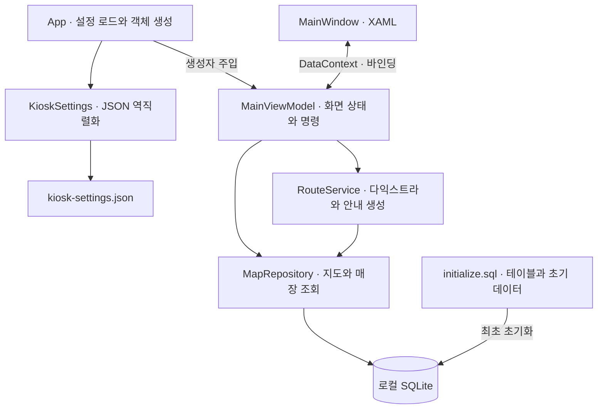

<div align="center">

# 🏬 MALL-WAY

**백화점 길찾기 키오스크의 CommunityToolkit.Mvvm 마이그레이션**

3개 층의 매장과 편의시설을 탐색하고, 현재 위치에서 목적지 입구까지 경로를 보여주는 Windows WPF 프로젝트


[마이그레이션](#-mvvm-light에서-toolkit으로-마이그레이션) · [업데이트](#-업데이트) · [주요 기능](#-주요-기능) · [설계 구조](#-설계-구조) · [실행 방법](#-실행-방법)

</div>

---

## 📌 프로젝트 소개

MALL-WAY는 C#과 WPF로 구현한 백화점 길안내 키오스크입니다. 매장명을 검색하거나 카테고리와 층별 지도에서 목적지를 선택하면 위치와 영업시간을 확인할 수 있습니다. 길찾기를 실행하면 1층 키오스크에서 목적지 입구까지 다익스트라로 경로를 계산하고, 층별 지도와 이동 안내를 제공합니다.

CommunityToolkit.Mvvm으로 화면 상태와 명령을 연결하며, WPF 앱이 로컬 SQLite 파일에 직접 접근합니다. 키오스크의 시작 위치와 기본 표시 층은 JSON 설정으로 관리합니다.

가상 백화점인 **아르온 백화점**을 대상으로 하며, 매장명과 지도 배치는 시연용으로 구성했습니다.

## 🔁 MVVM Light에서 Toolkit으로 마이그레이션

[원본 기준 커밋 330323b](https://github.com/baeseojin/MALL-WAY/commit/330323bcc166d5d533eb93b6172b4495dac04445)의 추적 파일을 가져와 마이그레이션했습니다. 실행 대상을 .NET 8 WPF로 전환했습니다. 초기 마이그레이션에서는 XAML, JSON 설정, SQLite 스키마와 길찾기 알고리즘을 유지했습니다. 이후 원본의 매장 상세 화면·한국어/영어 전환·저시력 모드와 README 업데이트를 이식했으며, .NET 8과 Toolkit 기반 구조는 유지합니다.

| 구분 | MVVM Light 버전 | CommunityToolkit.Mvvm 버전 |
| --- | --- | --- |
| 대상 프레임워크 | .NET Framework 4.8 (`net48`) | .NET 8 WPF (`net8.0-windows`) |
| ViewModel 기반 클래스 | ViewModelBase | ObservableObject |
| 변경 알림 | Set, RaisePropertyChanged | SetProperty, OnPropertyChanged |
| 버튼 명령 | GalaSoft RelayCommand | Toolkit RelayCommand |
| 명령 활성화 갱신 | RaiseCanExecuteChanged | NotifyCanExecuteChanged |
| 앱 시작 구성 | SimpleIoc 등록 및 CommonServiceLocator 조회 | App.xaml.cs에서 객체 생성 후 생성자로 전달 |

속성과 명령의 공개 이름을 유지해 기존 XAML 바인딩을 사용합니다. 속성과 명령은 직접 선언하는 형태로 마이그레이션했습니다.

## 🆕 업데이트

### 2026.11.11 · 매장 상세 화면 · 영어 지원 · 저시력 모드 추가

원본 MALL-WAY에 추가된 다음 세 가지 기능을 .NET 8·CommunityToolkit.Mvvm 구조에 맞춰 이식했습니다.

| 추가 기능 | 업데이트 내용 | 사용 방법 |
| --- | --- | --- |
| 🏪 매장 상세 화면 | 선택한 매장의 이름, 카테고리, 층·구역, 영업시간을 별도 화면에 표시하고 길찾기와 연결 | 지도 또는 검색 결과에서 매장 선택 → 상세정보 확인 → **길찾기**. **뒤로가기** 또는 `Esc`로 지도 복귀 |
| 🌐 한국어·영어 전환 | 화면 문구, 매장·편의시설 이름, 길찾기 안내를 선택한 언어로 표시. 한국어와 영어 매장명 모두 검색 가능 | 화면 상단의 **English / 한국어** 버튼으로 전환 |
| 👁️ 저시력 모드 | 고대비 색상, 큰 글씨와 버튼, 굵은 이동 경로, 스크롤 가능한 확대 지도 제공 | 화면 상단의 **저시력 모드**로 켜고 **일반 모드로**로 해제. 확대 지도는 가로·세로 스크롤로 탐색 |

언어 전환과 저시력 모드는 함께 사용할 수 있으며, 변경 시 선택한 매장과 현재 경로를 유지합니다. 앱을 다시 실행하면 한국어·일반 모드로 시작합니다.

## ✨ 주요 기능

| 영역 | 구현 내용 |
| --- | --- |
| 🔎 매장 검색 | 전체 층의 이름 부분 검색, 카테고리와 검색어 동시 적용, 검색 초기화 |
| 🗺️ 층별 지도 | 1F·2F·3F 전환, WPF 벡터 지도, 매장과 이동 시설 표시 |
| 📍 현재 위치 | 설정에 지정된 1층 키오스크를 빨간 표식으로 표시 |
| 🏪 매장 상세 | 지도·검색 결과 선택 시 상세 화면 표시, 뒤로가기·길찾기 연결 |
| 🌐 언어 전환 | 한국어·영어 즉시 전환, 두 언어로 매장 검색, 이동 안내 번역 |
| 👁️ 저시력 모드 | 고대비 테마, 큰 글씨·버튼, 굵은 경로와 스크롤 가능한 확대 지도 |
| 🎯 목적지 선택 | 검색 결과와 지도에서 선택, 해당 층으로 이동, 금색 강조 |
| 🚻 편의시설 | 화장실·수유실·고객센터·주차장 연결 통로 바로 찾기 |
| 🧭 최단 경로 | 다익스트라로 이동 비용이 가장 낮은 경로 계산 |
| 🛗 층간 안내 | 엘리베이터·에스컬레이터 탑승 위치와 하차층 안내 |
| 🟢 경로 표시 | 층별 녹색 이동 경로, 도착 지점, 경로 지우기 |
| ⚠️ 상태 처리 | 검색 결과 없음, 연결된 경로 없음, 지도 조회 오류 안내 |

### 백화점 구성

| 층 | 구성 | 가상 매장과 편의시설 |
| --- | --- | --- |
| 1F | 푸드코트 | 한끼마루, 소담면가, 구름다방, 고객센터, 화장실, 주차장 연결 통로 |
| 2F | 패션 | 모노핏, 온결웨어, 리프스튜디오, 스텝로그, 수유실, 화장실 |
| 3F | 영화관 | 루미시네마, 별빛스낵, 화장실 |

각 층에는 중앙 엘리베이터와 동쪽 에스컬레이터가 있습니다. 초기 데이터는 매장·편의시설 15곳, 이동 노드 31개, 양방향 연결 32개로 구성합니다.

## 🔄 이용 흐름


길찾기 중 층을 바꾸면 목적지를 유지하며 해당 층의 경로를 표시합니다. 다른 목적지를 선택하거나 검색 조건에서 기존 목적지가 제외되면 이전 경로를 해제합니다. 경로 지우기는 목적지를 유지한 채 선과 이동 안내를 지웁니다.

매장 선택 시 별도 상세 화면에서 이름, 카테고리, 위치, 영업시간을 확인합니다. 뒤로가기 또는 Esc로 지도에 돌아오며 선택은 유지됩니다. 상세 화면에서 길찾기를 누르면 출발층의 경로를 표시합니다.

상단의 **English / 한국어** 버튼으로 언어를 전환하고, **저시력 모드 / 일반 모드로** 버튼으로 표시 모드를 바꿉니다. 두 설정은 함께 사용할 수 있으며 선택한 매장과 경로를 유지합니다. 확대 지도는 가로·세로 스크롤로 탐색합니다. 앱을 다시 실행하면 한국어·일반 모드로 시작합니다.

번역은 `Resources/English.json`에서 관리하며 현재 가상 매장과 편의시설을 포함합니다. 새 매장을 추가할 때는 번역 목록에도 영어 이름을 등록합니다. 번역이 없는 사용자 데이터는 원문을 표시합니다. 표시용 번역만 적용하므로 기존 DB와 카테고리 필터 값은 유지됩니다.

## 🧰 기술 구성

| 구분 | 기술 |
| --- | --- |
| 언어 / 실행 환경 | C#, .NET 8 WPF, Windows x64 |
| UI | WPF, XAML, Canvas, Viewbox, 데이터 바인딩 |
| MVVM | CommunityToolkit.Mvvm 8.4.0, ObservableObject, RelayCommand |
| 객체 연결 | App.xaml.cs에서 생성자 주입 |
| 설정 | Newtonsoft.Json 13.0.4 |
| 데이터 저장 | SQLite, Microsoft.Data.Sqlite 8.0.30 |
| 경로 계산 | 다익스트라, 양방향 가중 그래프 |
| 버전 관리 | Git, 마이그레이션 저장소 main |

패키지 참조와 빌드 설정은 [프로젝트 파일](MALL-WAY/MALL-WAY.csproj)에서 확인할 수 있습니다.

## 🏗️ 설계 구조



### MVVM과 화면 갱신

`App.xaml.cs`에서 설정을 읽고 SQLite 저장소를 초기화합니다. 이어서 `RouteService`를 생성하고, 설정·저장소·경로 서비스를 `new MainViewModel(settings, repository, routeService)`에 전달합니다. 생성한 ViewModel은 창의 `DataContext`에 지정합니다. [앱 시작 코드](MALL-WAY/App.xaml.cs)

`MainViewModel`은 표시할 지도, 검색 조건, 선택한 매장, 경로를 관리합니다. 검색어나 카테고리 변경은 `SetProperty`로 알리고, 층이나 경로를 바꿀 때는 관련 속성에 `OnPropertyChanged`를 호출합니다. 목적지 선택이나 경로 변경으로 버튼 활성화 조건이 달라지면 Toolkit `RelayCommand`의 `NotifyCanExecuteChanged`를 호출합니다. 매장 강조는 `MapPlace.IsSelected`와 XAML의 `DataTrigger`로 처리합니다. [ViewModel 코드](MALL-WAY/MainViewModel.cs)

화면 표시 설정의 변경은 Toolkit의 변경 알림으로 전달합니다. 창을 닫을 때 `MainViewModel.Dispose()`에서 표시 설정 이벤트 구독을 해제합니다.

### 지도와 경로 데이터

| 테이블 | 역할 |
| --- | --- |
| `Floors` | 층 번호와 층 이름 |
| `Nodes` | 복도·매장 입구·키오스크·층간 이동 지점의 좌표 |
| `Places` | 매장 정보, 지도에 그릴 영역, 입구 노드 ID |
| `Edges` | 두 노드의 양방향 연결, 이동 비용, 이동 방식 |

매장 사각형은 `Places`의 영역 좌표로 그립니다. 길찾기는 `Nodes`에 저장한 입구 좌표까지 계산합니다. 층간 간선은 이동 안내로 설명하고, 지도에는 현재 층 안에서 이동하는 선분을 표시합니다.

## 💡 구현 포인트

- **설정과 지도 데이터 연결** — JSON에서 출발 노드 ID를 읽고 SQLite에서 실제 좌표를 조회합니다. 기본 표시 층과 키오스크의 실제 층을 따로 관리합니다.
- **전체 층 검색** — 시작 시 읽은 매장 목록을 메모리에서 필터링합니다. 결과에 층을 표시해 이름이 같은 층별 화장실을 구분합니다.
- **층간 경로 계산** — 복도와 층간 연결에 지정한 비용을 함께 비교합니다. 연속된 엘리베이터 이동은 안내를 묶고, 에스컬레이터는 층별 탑승·하차를 안내합니다.
- **선택 상태 관리** — 경로 안내 중 층 전환에도 목적지를 유지하고, 목적지 변경 시 이전 경로를 해제합니다. 지도 조회가 실패하면 기존 화면을 유지합니다.
- **DB 초기화** — 트랜잭션에서 테이블과 초기 데이터를 만들고 SQLite의 `user_version`을 1로 기록합니다. 다음 실행부터는 기존 DB를 사용합니다.
- **동기 처리 선택** — 현재 데이터 규모에 맞춰 SQLite 조회, 검색 필터링, 경로 계산을 동기로 처리합니다. 이동 비용은 경로 비교용 가중치입니다.

## 🚀 실행 방법

### 준비 환경

- Windows x64와 .NET 8 Desktop Runtime (x64)
- 빌드에는 .NET 8 SDK 또는 .NET 8을 대상으로 빌드할 수 있는 상위 SDK
- Visual Studio 사용 시 .NET 데스크톱 개발 워크로드
- 첫 NuGet 복원을 위한 네트워크 연결

### 1. 소스 가져오기

```powershell
git clone https://github.com/baeseojin/MALL-WAY-migration-.git
cd MALL-WAY-migration-
```

### 2. 빌드

Visual Studio에서 `MALL-WAY.sln`을 열고 F5로 실행하거나, 저장소 루트에서 다음 명령을 실행합니다.

```powershell
dotnet build .\MALL-WAY.sln
```

### 3. 앱 실행

```powershell
& .\MALL-WAY\bin\Debug\net8.0-windows\win-x64\MALL-WAY.exe
```

Release 구성은 다음 명령으로 빌드하고 실행합니다.

```powershell
dotnet build .\MALL-WAY.sln -c Release
& .\MALL-WAY\bin\Release\net8.0-windows\win-x64\MALL-WAY.exe
```

첫 실행에는 출력 폴더에 DB를 생성할 쓰기 권한이 필요합니다. 다른 PC나 폴더에서 실행할 때는 DLL, 설정, 초기 SQL을 포함한 **출력 폴더 전체**를 복사합니다.

### 4. 가상 매장으로 시연

1. 시작 화면에서 1층 지도와 빨간 현재 위치를 확인합니다.
2. `모노`를 검색하고 모노핏을 선택해 2층 지도, 금색 강조, 영업시간을 확인합니다.
3. 검색 초기화 후 루미시네마를 검색해 선택하고 길찾기를 누릅니다.
4. 1층에서 중앙 엘리베이터까지의 녹색 경로를 확인하고, 3F를 눌러 영화관 입구까지의 경로를 봅니다.
5. 화장실 바로가기에서 3층 화장실을 선택하고 길찾기를 누릅니다. 각 층 지도를 바꾸며 에스컬레이터 구간을 확인합니다.
6. 경로 지우기와 다른 목적지 선택으로 이전 경로가 해제되는지 확인합니다.

### JSON 설정과 DB 초기화

실행 파일 옆의 `kiosk-settings.json`을 Newtonsoft.Json으로 읽습니다.

```json
{
  "mallName": "아르온 백화점",
  "databasePath": "Data/department.db",
  "startNodeId": "1-kiosk",
  "defaultFloor": 1
}
```

| 설정 | 의미 |
| --- | --- |
| `mallName` | 창과 화면에 표시할 백화점 이름 |
| `databasePath` | SQLite 파일 경로, 상대 경로의 기준은 실행 파일 폴더 |
| `startNodeId` | 길찾기의 출발점인 키오스크 노드 |
| `defaultFloor` | 앱을 열 때 처음 표시할 층 |

새 DB는 `Data/initialize.sql`로 초기화합니다. 이미 `user_version = 1`인 DB에는 초기 SQL을 다시 적용하지 않습니다. 초기 SQL을 수정한 경우 기존 DB의 데이터는 그대로 유지되며, 변경을 반영하려면 별도 데이터 갱신이 필요합니다.

## 📁 프로젝트 구조

```text
MALL-WAY-migration-/
├── MALL-WAY.sln
├── README.md
├── .gitignore
└── MALL-WAY/
    ├── MALL-WAY.csproj
    ├── App.xaml / App.xaml.cs       # 시작 · 설정 · 생성자 주입
    ├── MainWindow.xaml / .xaml.cs   # 화면 · 지도 레이어 · 바인딩
    ├── MainViewModel.cs            # 검색 · 층 전환 · 선택 · 길찾기 명령
    ├── KioskSettings.cs            # JSON 읽기와 설정 검사
    ├── MapRepository.cs            # SQLite 조회 · 지도와 매장 모델
    ├── RouteService.cs             # 그래프 모델 · 다익스트라 · 안내 생성
    ├── DisplaySettings.cs          # 언어·저시력 설정 · Toolkit 기반 번역 바인딩
    ├── ThemePalette.cs             # 일반·고대비 색상과 글자 크기
    ├── Resources/English.json      # 화면·매장·시설의 영어 번역
    ├── kiosk-settings.json         # 키오스크 시작 설정
    └── Data/
        └── initialize.sql          # 테이블 · 가상 매장 · 경로 데이터
```

---

<div align="center">

**MALL-WAY · C# WPF 기반 백화점 검색 & 층별 경로 안내 프로젝트**

</div>
